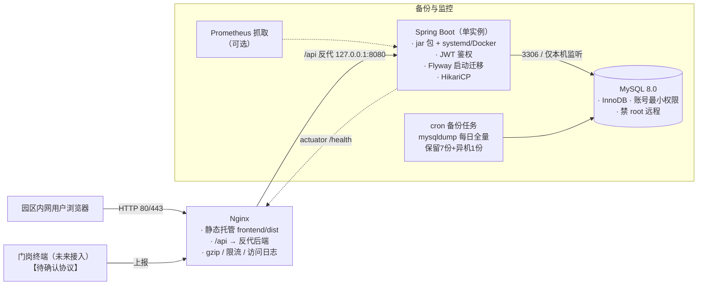

# 附录 01 · 架构评审（梁承宇 · 系统架构师）

> 归档说明：本文件为成员产出原文归档。**汇编裁决修正**：①本文 B5 中"字符串比较跨天/跨月排序出错"的表述已被裁决 11 纠正（定长零填充格式字典序=时间序，真实问题见原文后四点）；②本文选型表中 RPO/RTO 已按裁决 9 改为分层承诺（基础档 24h/4h，高保障档 15min/30min）；③时区一致性已升级为 Blocker 级（宿主机/JVM/jackson 三层，割接时执行四值时区验收命令：`date`、`timedatectl`、`docker exec smart-park-backend date`、`SELECT NOW()`）。以 `docs/delivery-improvement-plan.md` 为执行基准。

---

评审人：梁承宇（系统架构师）｜角色：只读评审，未修改任何文件
评审范围：后端 9 Controller / 9 Service / 8 Entity / 全部 common+config+task、schema.sql、application.yml、pom.xml、docs/api-contract.md、前端 request.js / vite.config.js / router / package.json、仓库根目录工程化配置。

---

## 一、已知 6 项关键事实复核结论（全部属实）

| # | 事实 | 复核结论 |
|---|------|---------|
| 1 | `schema.sql` 8 张表全部 `DROP TABLE IF EXISTS` 开头 + `spring.sql.init.mode: always` | ✅ 属实。`schema.sql` L2-L9 全部 DROP；`application.yml` L20-22 `mode: always`。Spring Boot 将 H2 识别为内嵌库，无论文件模式与否，每次启动都会执行 schema.sql + data.sql。**结论正确：每次重启清空全部业务数据** |
| 2 | H2 文件模式 `jdbc:h2:file:./data/smart-park`，sa/空密码，console 开启 | ✅ 属实。`application.yml` L9-19。补充：`web-allow-others: false` 只限制"非本机 IP"，若 Nginx 与应用同机部署（生产常态），经反代过来的请求源 IP 是 127.0.0.1，**H2 Console 实际可被任何能访问 8080 的人打开并直接操作数据库（空密码）** |
| 3 | pom 依赖仅 web/validation/mybatis-plus/h2/lombok，无 security/actuator/test | ✅ 属实，`pom.xml` L25-49 逐项核对 |
| 4 | 全项目无任何测试（无 src/test） | ✅ 属实，文件清单中无 src/test 目录 |
| 5 | 无 .gitignore/Dockerfile/docker-compose/CI/nginx/LICENSE，非 git 仓库 | ✅ 属实。补充发现：`smart-park-backend/.idea/` 整目录（含 workspace.xml、数据源历史）和 `data/smart-park.mv.db`（运行时数据文件）裸露在交付目录中；根目录下也无任何 README 之外的工程化文件 |
| 6 | 前端已存在 `dist/` 构建产物 | ✅ 属实（dist/assets + index.html）。风险：与 src 无版本对应关系，交付时不知是新是旧 |

---

## 二、深挖发现的架构级问题（按严重程度排序）

### B1.【致命】无任何鉴权，全部接口裸奔（README 假设 #2）
- **现象**：无 spring-boot-starter-security，9 个 Controller 共 40+ 个接口任何人可调。前端 axios 预留了 token 注入位置但无实现，router 无守卫。
- **客户现场会发生什么**：园区内网任何一台电脑用 curl 即可增删员工、把黑名单车辆改正常、审批贵重物资出库、删除访客记录（含身份证明文）。演示时无法回答"谁能操作、谁操作的"。
- **建议**：Spring Security + JWT 登录（无状态，适合单机部署），最小实现 2-3 角色（管理员/安保/仓管）+ 接口级注解鉴权；若客户已有统一身份中心（README 提到属既有平台能力）则对接 OIDC/LDAP——两种路线**需与客户确认**。
- **工作量**：自研 JWT 登录 3-5 人日（假设 2-3 固定角色、无复杂权限树）；对接客户身份中心 5-8 人日【待确认客户侧协议】。

### B2.【致命】定时任务多实例会重复告警 + 无分布式锁
- **现象**：`ScheduledTasks` 三个任务均为 `@Scheduled(fixedDelay=60_000)`，纯内存调度。`scanVisitors` 的防重逻辑依赖"先读 status 再更新"，两个实例并发时会同时读到"在场"，各插一条告警。
- **客户现场会发生什么**：一旦为可用性部署双实例（或运维无意间起了两个进程），访客滞留、物资逾期告警全部双份；单实例下进程崩溃则告警延迟不可控。
- **建议**：单机部署可保持现状但**在部署文档中硬性声明"只允许一个实例"**；同时给 `alarm` 表加业务幂等键（type+关联对象+日期唯一约束）兜底。若要 HA 再上 ShedLock。
- **工作量**：幂等键 0.5 人日；ShedLock 1 人日。

### B3.【严重】关键写操作存在并发竞态，无行锁/乐观锁
- **现象**：`StockRecordServiceImpl.stockOut/approve/returnBack` 均是"读物资状态 → 校验 → 更新"三步，中间无 `SELECT ... FOR UPDATE`、无 version 字段、H2 默认隔离级别下并发窗口完全敞开。员工/车辆/物资的"查重再插入"同理。
- **客户现场会发生什么**：两个仓管同时申领同一件（一物一码）物资，双双成功 → 台账显示物资在借给两个人，实物只有一件；物资编码重复时用户收到的是 500"系统异常"而非友好提示（唯一约束兜住了数据，但报错穿透）。
- **建议**：material 表加 `version` 字段走 MyBatis-Plus `@Version` 乐观锁（改动最小）；或出库/审批链路改悲观锁。MySQL 迁移后效果相同。
- **工作量**：1-2 人日。

### B4.【严重】统一返回体 HTTP 状态码恒为 200 + 500 泄露内部信息
- **现象**：`GlobalExceptionHandler` 返回 `Result` 但无 `@ResponseStatus`，所有错误（含 500）HTTP 层都是 200；`handleException` 把 `e.getMessage()` 直接拼进响应（"系统异常：..."），可能暴露 SQL 片段、表结构、H2 路径。
- **客户现场会发生什么**：运维监控、Nginx 错误统计、任何拨测工具全部失明（没有非 200）；同时给攻击者递刀子。
- **建议**：BizException→400/409，参数错→400，兜底→500 且 message 固定为"系统繁忙"，详细信息只进日志（带 traceId）；前端拦截器已兼容 HTTP 4xx 分支（request.js L32-37 已处理）。
- **工作量**：0.5-1 人日。

### B5.【严重】时间字段全部 VARCHAR(20)，且入参格式不校验
- **现象**：8 张表所有时间列（passTime/expireTime/expectReturnTime/startTime/endTime…）均为字符串。`DateTimes` 注释自辩"定长格式可字符串比较"——仅在格式正确时成立，但 `StockOutRequest.expectReturnTime`、`AccessPermission.startTime/endTime` 等只有 `@NotBlank` 没有 `@Pattern` 格式校验。DB 层无 DATETIME 类型。
- **客户现场会发生什么**：录一个"2026/10/30"或"明天下午"格式的归还时间 → 字符串比较错乱 → 逾期扫描永远不触发或全部误触发；做数据归档/迁移/聚合时无日期函数可用。
- **建议**：DTO 层立即加 `@Pattern(yyyy-MM-dd HH:mm:ss)` 校验（0.5 人日，**必须做**）；存储类型改 DATETIME 属于数据建模范畴，由数据建模工程师在 MySQL 迁移时一并处理。

### B6.【严重】身份证明文全量落库
- **现象**：契约与代码一致——`visitor.idCard` 存储全量明文，仅接口返回脱敏。无加密、无访问控制（结合 B1，等于明文 PII 对全网开放）。
- **客户现场会发生什么**：违反《个人信息保护法》对敏感个人信息的存储要求；一旦泄露（或被内网随意拉取），客户与乙方都有合规责任。
- **建议**：至少 AES 加密落库（密钥外置于配置/环境变量），配合鉴权上线后限定可查看明文的角色；保留期与销毁策略【待确认客户合规要求】。
- **工作量**：加密改造 2-3 人日（含存量数据迁移脚本）。

### B7.【中等】看板接口全表加载、内存聚合，规模不可扩展
- **现象**：`DashboardServiceImpl.accessTrend()` 把近 7 天全部 `access_record` 拉进 JVM 用 stream 分组计数；`materialStatus()` 全表 `selectList(null)`。通行流水是唯一只增不减的表。
- **客户现场会发生什么**：假设 4 个门岗每天 5000 条流水，一年后单次看板请求要加载 180 万行到内存——看板越来越慢直至 OOM，且是所有登录用户共享的故障点。
- **建议**：聚合下推 SQL（GROUP BY 按天）；中期加 30-60s 本地缓存（Caffeine）。归档策略与保留期见非功能目标。
- **工作量**：1-2 人日（含缓存）。

### B8.【中等】分页 pageSize 无上限 + 通行上报无幂等键
- **现象**：所有 pageQuery 接受任意 pageSize；`/access-records/simulate`（README 假设 #3：等价于终端上报）无请求去重机制，网络重试即重复流水。
- **客户现场会发生什么**：接口被恶意或误传大 pageSize 拖垮服务；真实终端接入后网络抖动产生重复通行记录，看板统计失真。
- **建议**：pageSize 服务端 clamp 到 ≤200；simulate 接口预留幂等设计（deviceId+timestamp 去重），在真实终端接入前完成。
- **工作量**：clamp 0.25 人日；幂等键 1 人日（依赖终端接入协议【待确认】）。

### B9.【中等】物理删除 + 无操作审计
- **现象**：员工/车辆/访客/权限/物资全部物理删除（仅物资有"在借不可删"保护）；无任何操作日志表。流水表用 empNo/plateNo 字符串冗余，删主档后流水变"孤儿"。
- **客户现场会发生什么**：误删无救济；门禁拦截记录查不到对应人；客户审计追问"这条贵重物资出库是谁批准的"时无法回答。
- **建议**：改软删除（deleted 标记）+ 最小操作审计表（who/when/what/结果），审计表只追加。
- **工作量**：2-3 人日。

### B10.【低】可观测性为零
- **现象**：无 actuator（Nginx/k8s 无法做健康检查与优雅重启联动）、无请求日志、无 traceId、`logging.level` 仅 mapper:warn。
- **建议**：actuator（暴露 health/info，关掉其余端点）+ logback 滚动文件 + 访问关键链路 INFO 埋点。
- **工作量**：1 人日。

### B11.【低】契约一致性核对结论
- **总体**：`docs/api-contract.md` 与后端实现**基本一致**，路径/方法/参数/分页结构/状态机逐条核对无冲突。唯一增量差异：后端实现了 `GET /visitors/{id}`（契约未列），属非破坏性新增，建议补进契约文档。
- **风险**：契约是手写 Markdown，无自动化校验，后端改接口不会同步契约。建议 springdoc-openapi 生成 OpenAPI 文档作为活契约。

### B12.【低】工程化卫生问题
- `.idea/` 目录（含个人工作区配置）、`data/smart-park.mv.db`（运行时数据）、`dist/`（陈旧构建产物）混在交付物里；非 git 仓库 → 无法回滚、无法追溯变更、热修复无法验证（叠加事实 4 无测试）。
- **建议**：初始化 git + .gitignore（排除 .idea/data/dist/target/node_modules）+ 打 tag 出交付基线。0.5 人日。

---

## 三、生产化技术选型表

| 领域 | 现状 | 建议主选 | 被否决的备选 | 否决理由 | 适用前提 |
|------|------|---------|-------------|---------|---------|
| 数据库 | H2 文件模式（重启清库、sa 空密码、console 裸奔） | **MySQL 8.0**（客户现场单机安装，InnoDB） | ① H2 生产化：并发写弱、无细粒度账号权限、无生态工具，一旦出问题无人会救；② PostgreSQL：技术上完全胜任，但园区/国企现场运维人才以 MySQL 居多；③ 达梦/openGauss：仅在客户有国产化要求时启用【待确认】 | 客户现场具备或可采购基本 MySQL 运维能力（假设成立，国内园区场景普遍） |
| Schema 迁移 | schema.sql DROP+CREATE + always | **Flyway**（V1 基线化现有 8 表，之后增量脚本） | ① Liquibase：XML/changelog 学习与维护成本高于团队所需；② 继续用 sql.init：已被证实等于"每次重启清库" | 迁移到 MySQL 同步进行，基线脚本一次写好 |
| 鉴权 | 无 | **Spring Security + JWT**（无状态，单机友好），2-3 固定角色 | ① Session+Redis：引入额外组件，单机部署不划算；② Keycloak：IDP 太重，园区内网规模不需要 | 若客户统一身份中心可对接【待确认】则改 OIDC/LDAP 路线 |
| 连接池 | H2 直连（未显式配置） | **HikariCP**（Boot 默认，切 MySQL 后自动生效，显式设 max-pool-size=15） | Druid：监控面板方便但历史漏洞多、依赖重，本项目用不到其核心能力 | 单机，15 连接远超业务需要 |
| 可观测性 | 无 | **Actuator(health/info) + Micrometer + Prometheus + Grafana + logback 滚动文件日志** | ① ELK/Loki 全家桶：单机园区规模过重；② SkyWalking：分布式追踪，单体无必要 | Grafana 可选（至少保留 actuator + 文件日志） |
| 缓存 | 无 | **暂不引入**；看板接口加 **Caffeine** 本地缓存（30-60s TTL） | Redis：新增组件、运维面扩大，当前数据量/并发下属过度设计。触发条件（满足任一再引入）：dashboard P95>500ms、部署多实例、出现会话共享需求 | — |
| API 文档 | 手写 api-contract.md | **springdoc-openapi** 生成 OpenAPI 3，CI 中做契约比对 | SpringFox/Swagger2：不兼容 Boot 3、停止维护 | — |
| 定时任务 | @Scheduled 单实例 | **保持 @Scheduled + alarm 幂等键兜底**；多实例时加 ShedLock | ① Quartz 集群：引入 11 张 QRTZ_ 表，重量远超需要；② XXL-Job：需要额外调度中心 | — |
| 部署形态 | 无任何部署资产 | **Docker Compose 单机栈**（nginx + app + mysql + 备份 sidecar）或 systemd + 裸机 MySQL 二选一【待确认客户现场是否允许 Docker】 | K8s：单客户单站点规模下纯增加复杂度 | 客户现场为内网单机【待确认】 |

---

## 四、非功能性目标建议（未确认项均标注【待确认】）

| 维度 | 建议目标 | 依据/验证方式 |
|------|---------|--------------|
| 并发量级 | 管理端在线用户 ≤50；页面峰值 QPS ≤50；通行上报峰值 ≤10 QPS | 【待确认：门岗终端数量与上报频率】。压测用 JMeter 按此目标验证 |
| 响应时间 | 列表/表单类 P95 < 500ms；看板 P95 < 1s；写接口 P95 < 300ms | H2→MySQL 后单表分页查询完全可达；上线前压测一轮 |
| 数据量与保留 | access_record 假设 5000 条/天 → 年约 180 万行；流水建议保留 ≥12 个月，超期归档【待确认：客户审计/合规要求的最短保留期】 | 归档前对 pass_time 建索引已有；MySQL 分区表可选 |
| 可用性 | 工作时段可用性 ≥99%；单点故障 RTO ≤ 4h（单机冷备重启）【待确认客户 SLA 要求】 | actuator 健康检查 + 备份可恢复演练（每季度 1 次） |
| 备份/RPO | 每日 mysqldump 全量 + binlog，本地保留 7 份 + 异机/异地存 1 份，RPO ≤ 24h【待确认客户是否要求更小 RPO】 | 恢复演练脚本化，恢复时间目标 < 1h |
| 安全 | 全接口鉴权、PII 加密、无 500 详情外泄、CORS 同源收紧 | 上线前安全自查清单 + 简单渗透（越权/重放/注入抽查） |

> 【汇编裁决 9 修正】RPO/RTO 对外承诺改为分层：基础档（默认交付）RPO 24h / RTO 4h；高保障档（客户选购，含 binlog 近实时备份与恢复演练服务）RPO 15min / RTO 30min。

---

## 五、生产目标部署架构

要点：① Nginx 与应用同机，后端 8080 仅绑 127.0.0.1；② MySQL 仅本机监听、专用账号最小权限；③ 单实例是硬性约束（见 B2），若升双实例需同步引入 ShedLock + Redis Session；④ H2 Console 在生产配置中彻底关闭。

---

## 六、整改清单（三档）

### 🔴 上线阻断项（Blocker，不做不能交付）
| # | 事项 | 对应问题 | 工作量（人日） |
|---|------|---------|--------------|
| 1 | 移除 sql.init always + schema DROP 逻辑，迁移 MySQL + Flyway 基线 | 事实1/2 | 2 |
| 2 | 关闭 H2 console（随 #1 消亡，若保留 H2 演示模式则必须关） | 事实2 | 0.25 |
| 3 | 登录鉴权（JWT + 2-3 角色 + 接口注鉴权 + 前端路由守卫） | B1 | 3-5 |
| 4 | CORS 收紧：删 `*`，生产同源部署（Nginx 托管 dist + 反代 /api）后可整体移除 CorsConfig | B1/事实6 | 0.5 |
| 5 | 备份策略落地：每日全量 + 保留策略 + **恢复演练** + 运维手册 | 选型/非功能 | 1 |
| 6 | 生产配置分离（application-prod.yml）、账号密码外置环境变量、日志输出到文件 | B10 | 0.5 |
| 7 | Nginx 配置 + 部署文档（含"仅允许单实例"硬性声明） | B2 | 1 |

**Blocker 合计约 8-10 人日。**

### 🟠 强烈建议项（上线后第一迭代完成）
| # | 事项 | 对应问题 | 工作量 |
|---|------|---------|--------|
| 8 | 全局异常改进：真实 HTTP 状态码 + 500 不外抛细节 + traceId 日志 | B4 | 0.5-1 |
| 9 | 出库/审批/归还乐观锁（material.version） | B3 | 1-2 |
| 10 | 时间字段 DTO 格式校验 @Pattern | B5 | 0.5 |
| 11 | 身份证 AES 加密落库 + 存量迁移 | B6 | 2-3 |
| 12 | pageSize 上限 clamp | B8 | 0.25 |
| 13 | alarm 幂等键（应对未来多实例） | B2 | 0.5 |
| 14 | Actuator health + 滚动日志 + 最小监控 | B10 | 1 |
| 15 | git 仓库 + .gitignore + 交付 tag + 清理 .idea/data/dist 出交付物 | B12 | 0.5 |
| 16 | 核心链路最小测试集（出库-审批-归还、访客签到签退、模拟通行）+ CI | 事实4 | 3-5 |
| 17 | Dockerfile / compose（若客户允许容器化） | 选型 | 2 |

**约 12-16 人日。**

### 🟡 可选优化项（随版本节奏排）
| # | 事项 | 工作量 |
|---|------|--------|
| 18 | 看板聚合下推 SQL + Caffeine 缓存 | 1-2 |
| 19 | springdoc-openapi 活文档 + 契约 CI 比对 | 1 |
| 20 | 软删除 + 操作审计表 | 2-3 |
| 21 | 告警通知渠道（邮件/webhook/企业微信） | 2 |
| 22 | simulate 幂等设计（依赖真实终端协议） | 1 |
| 23 | Nginx 限流 limit_req | 0.5 |
| 24 | 存储层 VARCHAR→DATETIME（与数据建模工程师协同，MySQL 迁移窗口一并做） | 并入 #1 |

### 待确认清单（阻塞排期的客户侧问题）
1. 客户是否已有统一身份中心，鉴权走自研 JWT 还是对接 OIDC/LDAP？（决定 #3 的 3 天还是 8 天）
2. 客户现场操作系统与是否允许 Docker？（决定部署形态）
3. 是否有国产化数据库要求（达梦/openGauss）？
4. 门岗终端品牌与上报协议（决定 #22）？
5. SLA/RPO 客户是否有成文要求（影响备份频率与是否需要双机）？
6. 访客身份证等 PII 的保留期与销毁要求（合规）？
7. 通行流水审计保留年限（影响归档策略）？

**总体结论**：代码分层规范（Controller 薄、Service 厚、无循环依赖、统一返回体设计意图清晰），作为演示/原型质量是合格偏优的；但按"生产交付"标准，当前状态**不具备上线条件**——核心阻断点集中在"数据不持久（重启清库）、接口不设防（无鉴权）、无灾备（无备份）"三件事，均为客户现场第一天就会暴露的问题。完成 Blocker 档 8-10 人日改造后，方可进入试点上线。
